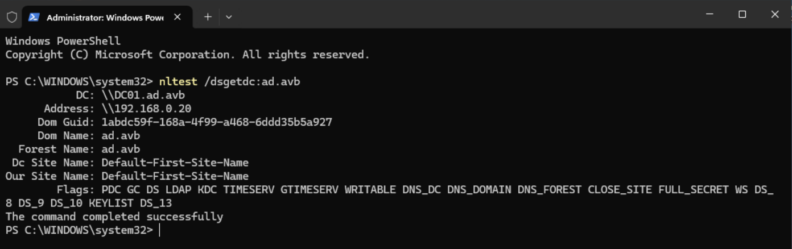
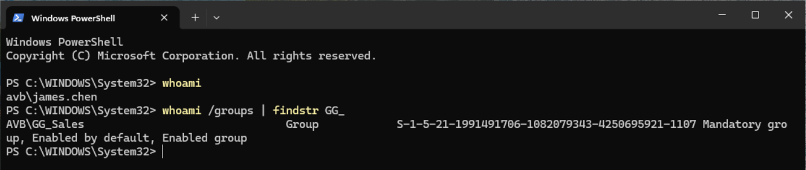
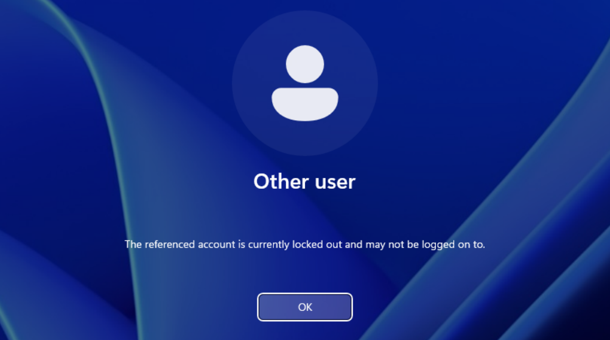
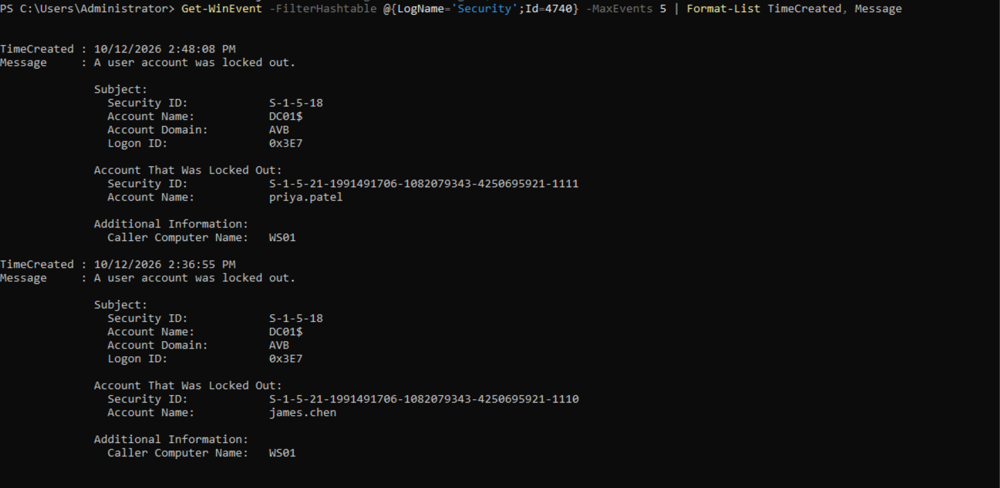
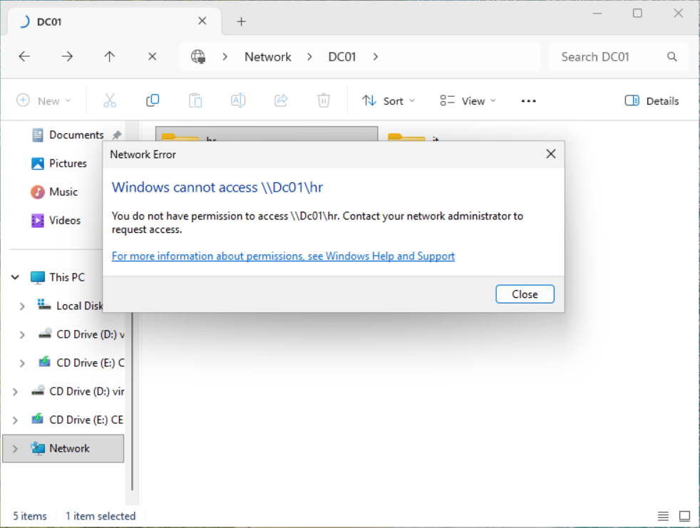
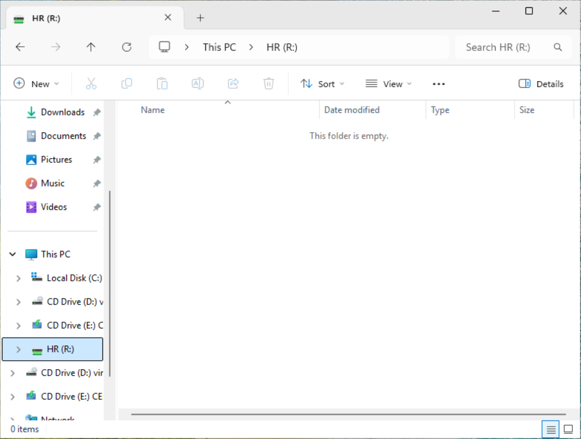
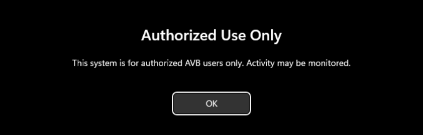

# Active Directory Lab

A Windows domain built on my Proxmox homelab to practice the day to day work of help desk and desktop support: user lifecycle, account lockouts, file share permissions, and Group Policy.

## Environment

| Item | Details |
|---|---|
| Hypervisor | Proxmox VE on a Dell OptiPlex 7070 Micro (i5-9500T, 16GB RAM) |
| DC01 | Windows Server 2025, **Server Core** (no Desktop Experience), 192.168.0.20 |
| WS01 | Windows 11 Enterprise, domain joined |
| Domain | `ad.avb` (NetBIOS name `AVB`) |
| DNS | WS01 points only at DC01. DC01 forwards outside queries to Pi-hole (192.168.0.143), so domain clients keep ad blocking |
| Management | DC01 is managed remotely from WS01 with RSAT (ADUC, Group Policy Management, DNS) |

## Health checks

Before building anything, I confirmed the domain itself was healthy.

```powershell
# On WS01
nltest /dsgetdc:ad.avb            # locates DC01 through DNS
Get-DnsClientServerAddress -AddressFamily IPv4   # only 192.168.0.20
w32tm /query /source              # time source is DC01.ad.avb (Kerberos needs synced clocks)
Test-NetConnection google.com     # internet works through DC01 > Pi-hole

# On DC01
dcdiag /q                         # no output means every test passed
Get-DnsServerForwarder            # Pi-hole
```



## OU structure

The default `Users` and `Computers` folders are containers, not OUs, so GPOs can't be linked to them. Everything lives under a custom `AVB` OU instead.

```
ad.avb
└── AVB
    ├── Users
    │   ├── IT
    │   ├── Sales
    │   └── HR
    ├── Computers
    │   └── Workstations
    ├── Groups
    └── Disabled
```

```powershell
$avb = "OU=AVB,DC=ad,DC=avb"
New-ADOrganizationalUnit -Name "Disabled" -Path $avb
"IT","Sales","HR" | ForEach-Object {
    New-ADOrganizationalUnit -Name $_ -Path "OU=Users,$avb"
}
New-ADOrganizationalUnit -Name "Workstations" -Path "OU=Computers,$avb"

# Send future domain joins to Workstations instead of the default container
redircmp "OU=Workstations,OU=Computers,$avb"
```

## Users and groups

* One global security group per department: `GG_IT`, `GG_Sales`, `GG_HR`
* Users follow `first.last` naming, with UPNs in the form `first.last@ad.avb`
* My own accounts are split: `alex` for daily use, `alex.admin` (Domain Admins) for administration

```powershell
$pw = Read-Host "Lab password" -AsSecureString
$people = @(
    @{F="Maria"; L="Lopez";  D="IT"},
    @{F="James"; L="Chen";   D="Sales"},
    @{F="Priya"; L="Patel";  D="Sales"},
    @{F="Kevin"; L="Brooks"; D="HR"},
    @{F="Dana";  L="Rivera"; D="HR"}
)
foreach ($p in $people) {
    $sam = "$($p.F).$($p.L)".ToLower()
    New-ADUser -Name "$($p.F) $($p.L)" -GivenName $p.F -Surname $p.L `
        -SamAccountName $sam -UserPrincipalName "$sam@ad.avb" `
        -Department $p.D -Path "OU=$($p.D),OU=Users,$avb" `
        -AccountPassword $pw -Enabled $true
    Add-ADGroupMember "GG_$($p.D)" -Members $sam
}
```

Verified with a real sign in on WS01, then `whoami /groups` to confirm the group appeared in the user's Kerberos token.



## Account lockout policy

Set in the **Default Domain Policy** through Group Policy Management:

| Setting | Value |
|---|---|
| Account lockout threshold | 5 invalid attempts |
| Account lockout duration | 15 minutes |
| Reset lockout counter after | 15 minutes |

Password and lockout settings for domain accounts only take effect at the domain level. Linking them to an OU does nothing for domain users (Fine Grained Password Policies are the tool for per group rules).

## Help desk drills

### Unlock and reset (PowerShell)

Locked out `james.chen` with 5 bad passwords on WS01:



Then resolved it as help desk:

```powershell
Search-ADAccount -LockedOut | Select SamAccountName
Unlock-ADAccount james.chen
Set-ADAccountPassword james.chen -Reset -NewPassword (Read-Host "Temp password" -AsSecureString)
Set-ADUser james.chen -ChangePasswordAtLogon $true
```

The user was then forced to choose a new password at next sign in.

### Unlock and reset (ADUC)

Locked out `priya.patel`, then used ADUC: Reset Password with "User must change password at next logon" and "Unlock the user's account" checked. This is the flow most help desks use on a ticket.

### Finding the source of a lockout

Event ID 4740 in the DC's Security log records each lockout and the machine the bad attempts came from:

```powershell
Get-WinEvent -FilterHashtable @{LogName='Security';Id=4740} -MaxEvents 5 |
    Format-List TimeCreated, Message
```



Both lockouts showed `Caller Computer Name: WS01`. In production, this is how you find the phone or mapped drive still holding an old password.

## File shares (AGDLP)

Permissions follow **AGDLP**: **A**ccounts go into **G**lobal groups (by role), global groups go into **D**omain **L**ocal groups (by resource), and only the domain local groups get **P**ermissions. Moving someone between departments means changing one group membership, never editing folder permissions.

```
james.chen > GG_Sales > DL_Share_Sales_RW > Modify on C:\Shares\Sales
```

```powershell
"IT","Sales","HR" | ForEach-Object {
    New-ADGroup -Name "DL_Share_$($_)_RW" -GroupScope DomainLocal -GroupCategory Security -Path "OU=Groups,$avb"
    Add-ADGroupMember "DL_Share_$($_)_RW" -Members "GG_$_"

    $path = "C:\Shares\$_"
    New-Item -ItemType Directory -Path $path -Force | Out-Null
    New-SmbShare -Name $_ -Path $path -FullAccess "AVB\Domain Admins" `
        -ChangeAccess "Authenticated Users" -FolderEnumerationMode AccessBased

    # Remove inherited permissions; grant only admins, SYSTEM, and the DL group
    icacls $path /inheritance:r /grant "AVB\Domain Admins:(OI)(CI)F" "SYSTEM:(OI)(CI)F" "AVB\DL_Share_$($_)_RW:(OI)(CI)M"
}
```

Share permissions are intentionally broad and NTFS does the real control. When both apply, the more restrictive one wins.

**Tested as james.chen (Sales):** created a file in `\\DC01\Sales`; `\\DC01\HR` and `\\DC01\IT` returned "You do not have permission."



## GPO: department drive maps

GPO `Map Department Drives`, linked to `AVB > Users`, using Group Policy Preferences with item level targeting by security group:

| Drive | Path | Targeted to |
|---|---|---|
| S: | `\\DC01\Sales` | GG_Sales |
| I: | `\\DC01\IT` | GG_IT |
| R: | `\\DC01\HR` | GG_HR |

Verified by signing in as one user per department: each received only their own drive.



## GPO: workstation login banner

GPO `Workstation Login Banner`, linked to `AVB > Computers > Workstations`. Set under Computer Configuration > Policies > Windows Settings > Security Settings > Local Policies > Security Options:

| Setting | Value |
|---|---|
| Interactive logon: Message title for users attempting to log on | Authorized Use Only |
| Interactive logon: Message text for users attempting to log on | This system is for authorized AVB users only. Activity may be monitored. |

Applied with `gpupdate /force` on WS01 and confirmed with `gpresult /r /scope computer`. The banner now appears before every sign in:



This is a **computer** setting, so it applies based on the OU the computer object is in. Linking it to the Users OU would do nothing, because no computer objects live there (making that work requires loopback processing). It is also the opposite of the lockout policy: account policies are processed by the DC, while this one is applied by the workstation itself.

## Troubleshooting notes

Problems I hit and what they taught me:

* **`AD\james.chen` failed but `james.chen@ad.avb` worked.** The NetBIOS name is `AVB`, not `AD`. The down level logon prefix comes from the NetBIOS name, which can differ from the DNS domain name. Confirmed with `(Get-ADDomain).NetBIOSName` and `whoami`.
* **Lockout policy didn't apply after `gpupdate` on WS01.** Domain account policies are processed by the DC, not the client. Running `gpupdate /force` on DC01 applied it immediately.
* **`ADPasswordComplexityException` during a reset.** The temp password didn't meet domain complexity rules.
* **Access based enumeration didn't hide HR and IT from `\\DC01`.** ABE only hides folders and files *inside* a share, not the share list itself. The usual fixes are a single share with department subfolders, or mapping drives so users never browse the server.
* **R: drive missing for Kevin even though the GPO was correct.** The mapping only appeared after a fresh Explorer window / sign in. Drive maps apply at sign in, so checking `net use` before changing anything is the right first step.

## Next steps

* USB storage restrictions for one department
* Remove Control Panel access for non IT users
* Windows LAPS for local admin passwords
* Delegate password resets to a Help Desk group on the Users OU only
* Offboarding drill: disable, strip groups, move to Disabled OU
